# Reto 2 (Evaluable) · Despliegue en Producción y Hardening

> **Módulo:** 0377 · Administración de Sistemas Gestores de Bases de Datos (ASGBD) · ASIR
> **Tipo:** Reto evaluable. Continuación del Laboratorio Base (Oracle Database 21c XE en VirtualBox).

## Metadatos del operador

| Campo | Valor |
|---|---|
| **Alumno** | Tomas Franco Brusse |
| **Usuario de GitHub** | [@Tomyfrbr](https://github.com/Tomyfrbr) |
| **IP del servidor (VM, Host-Only)** | `192.168.56.10` |
| **IP del cliente (PC físico, Host-Only)** | `192.168.56.1` |
| **Service Name utilizado en DBeaver** | `XE` (contenedor `CDB$ROOT`) |
| **Fecha** | 20/10/2026 |

---

## 1. Objetivo

Pasar a producción el entorno del laboratorio cerrando dos agujeros:

1. **Firewall:** que el puerto 1521 solo acepte conexiones desde mi PC y no desde cualquiera.
2. **Mínimo privilegio:** crear `usuario_restringido`, que puede conectarse pero no administrar nada.

Uso la misma VM de los anteriores (Windows 10 en vez de Windows 11, para esto da igual), con `OracleServiceXE` y el listener arrancados, la regla del 1521 creada en el Reto 1 y DBeaver en mi PC. `admin_udit` lo creé en el laboratorio con rol DBA.

### 1.1 IP reales

Con `ipconfig` en cada equipo:

| Equipo | IP Host-Only |
|---|---|
| VM (servidor) | `192.168.56.10` |
| PC físico (cliente) | `192.168.56.1` |

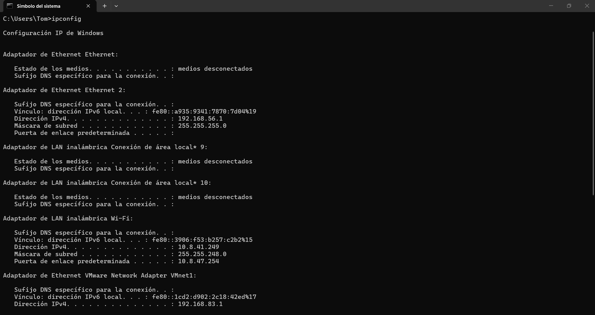

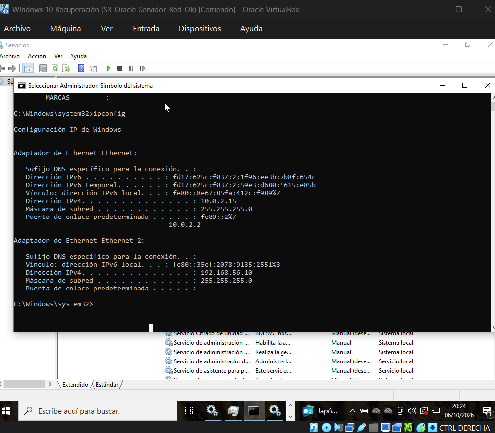

---

## 2. Fase 1 · Hardening del Firewall

Mi regla se llama `Oracle XE 1521` (la creé así en el Reto 1). Hasta ahora dejaba entrar a toda la red Host-Only (`192.168.56.0/24`), así que cualquier máquina de esa red podía llegar al puerto. La cerré para que solo entre mi PC:

1. `wf.msc` → Reglas de entrada → doble clic en `Oracle XE 1521`.
2. Pestaña **Ámbito** → Dirección IP remota → quité `192.168.56.0/24` y agregué `192.168.56.1`.
3. Aplicar → Aceptar.

📸 **Evidencia 1:** pestaña Ámbito con la IP autorizada.

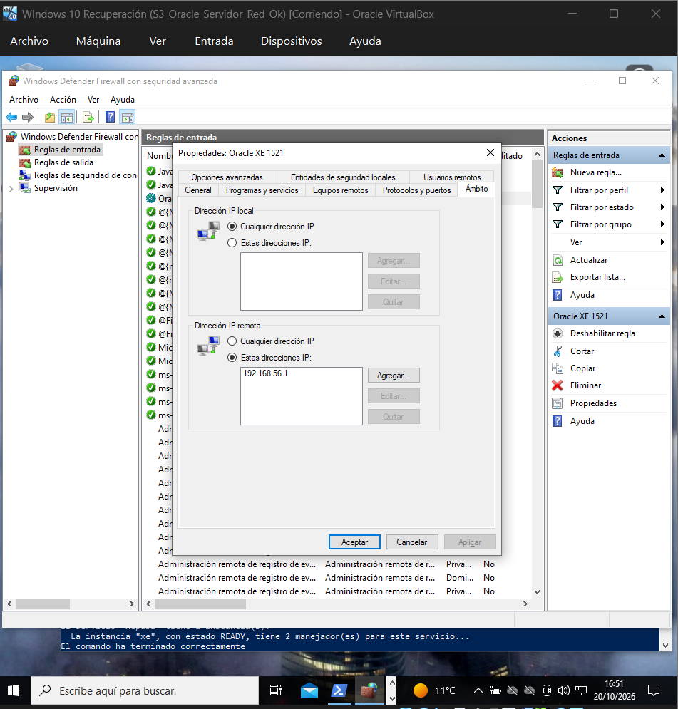

---

## 3. Fase 2 · Conectividad y validación

### 3.1 Comprobaciones previas

Antes de probar nada miré en la VM que Oracle estuviera funcionando, para que si luego salía un `False` supiera que no es culpa de Oracle:

```powershell
Get-Service -Name OracleServiceXE
Get-Service | Where-Object { $_.Name -like "*TNSListener*" }
lsnrctl status
```

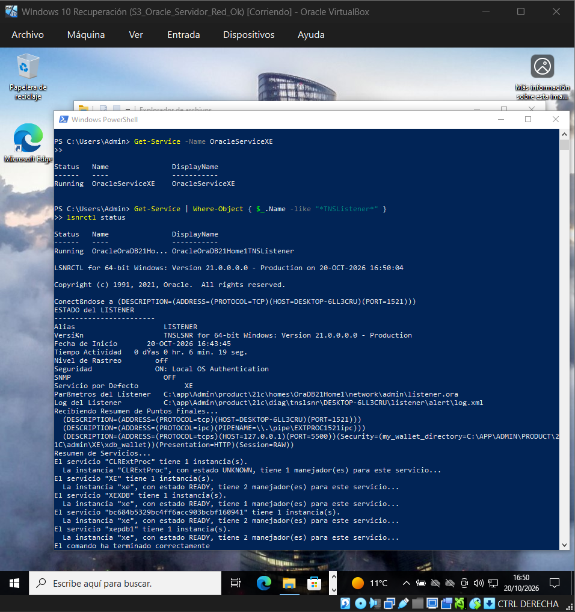

Los dos servicios están en `Running` y el listener tiene el servicio `XE` en `READY`. También sale `xepdb1`, que es la PDB (me sirve luego para el apartado 4).

> Antes de esto tuve que arreglar el reloj de la VM: se había quedado en el 06/10 porque siempre la cerraba con "Guardar estado" en vez de apagarla. Instalé las Guest Additions y reinicié desde Windows (por eso el listener lleva solo 6 minutos encendido).

### 3.2 Desde el cliente autorizado (mi PC)

```powershell
Test-NetConnection -ComputerName 192.168.56.10 -Port 1521
```

Sale `TcpTestSucceeded : True`.

### 3.3 Desde un equipo no autorizado

No podía hacerlo con un compañero porque la red Host-Only solo existe dentro de mi ordenador. Así que usé otra máquina virtual mía, la **Kali**, como "intruso": le añadí un adaptador más en la red Host-Only (sin tocar los que ya tenía para otras prácticas) y le puse la IP `192.168.56.20`, que no está en la regla.

En la Kali:

```bash
sudo ip addr add 192.168.56.20/24 dev eth2
ping -c 4 192.168.56.10
nc -zv -w 5 192.168.56.10 1521
sudo nmap -Pn -p 1521 192.168.56.10
```

- `ip addr add` le pone la IP a mano (temporal, se quita al reiniciar).
- El **ping responde**, o sea que la Kali sí llega a la VM. Sin esto el resultado negativo no valdría nada.
- `nc` intenta conectar al puerto 1521 y se rinde a los 5 segundos: **Connection timed out**.
- `nmap` dice **`1521/tcp filtered`**. "Filtered" significa que algo se está tragando los paquetes sin contestar, que es lo que hace un firewall. Si el listener estuviera apagado diría `closed`.

Como Oracle está en marcha (3.1) y mi PC sí entra (3.2), lo único distinto es la IP de origen: la regla bloquea a la Kali.

📸 **Evidencia 2:** a la izquierda mi PC con `True`; a la derecha la Kali con ping correcto y el puerto bloqueado.

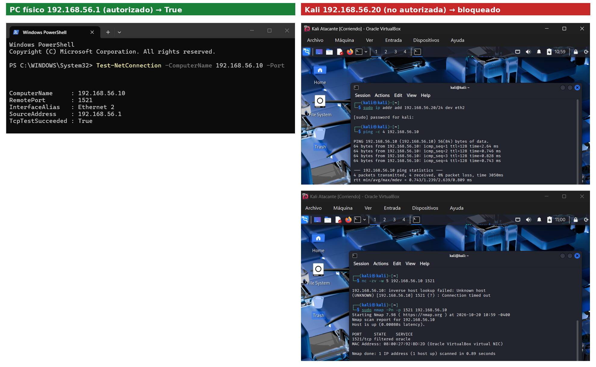

### 3.4 Conexión con DBeaver como `admin_udit`

Nueva conexión en DBeaver con estos datos (le puse de nombre `XE - admin_udit` para que en las capturas se vea con qué usuario estoy):

| Parámetro | Valor |
|---|---|
| **Host** | `192.168.56.10` |
| **Puerto** | `1521` |
| **Service Name** | `XE` |
| **Usuario** | `admin_udit` |

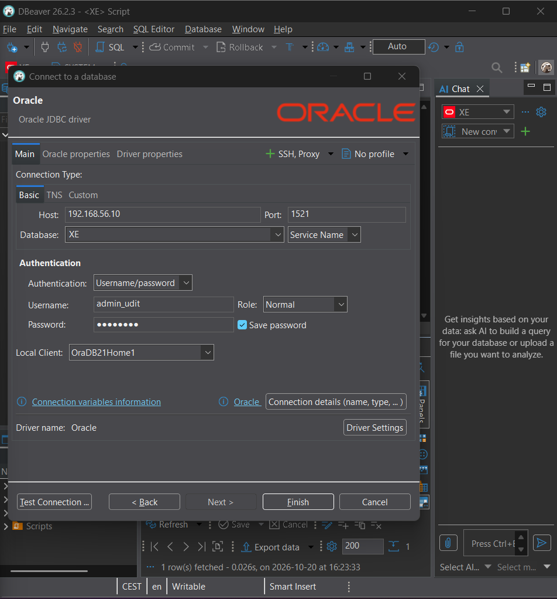

```sql
SELECT SYS_CONTEXT('USERENV','SESSION_USER') AS usuario,
       SYS_CONTEXT('USERENV','CON_NAME')     AS contenedor
FROM DUAL;
```

📸 **Evidencia 3:** sale `ADMIN_UDIT` en `CDB$ROOT` (el contenedor principal, que es donde lo creé en el laboratorio).

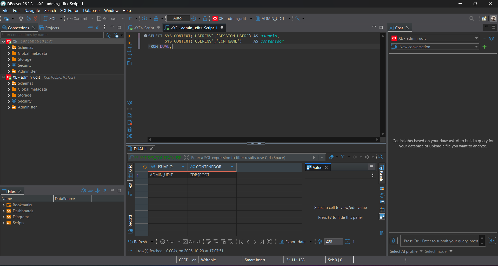

---

## 4. Fase 3 · Principio de mínimo privilegio

### 4.1 y 4.2 Contenedor

El profe pide comprobar en qué contenedor estoy y qué PDB hay:

```sql
SELECT SYS_CONTEXT('USERENV','CON_NAME') AS contenedor_actual FROM DUAL;
SELECT NAME, OPEN_MODE FROM V$PDBS;
```

El contenedor ya lo había visto en la evidencia 3 (`CDB$ROOT`). Lo curioso fue el `V$PDBS`: como `admin_udit` no sale **nada**.

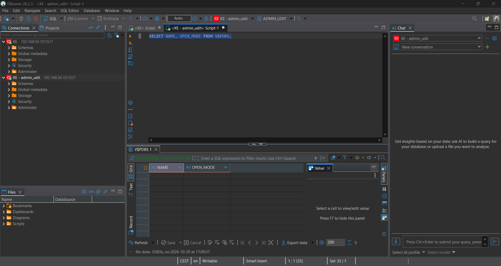

No es que no haya PDB. Es que `admin_udit`, aunque tenga rol DBA, desde el contenedor principal solo ve los datos de ese contenedor; para ver los de las PDB hace falta un permiso extra que `SYSTEM` tiene de serie. Lo repetí como `SYSTEM` y ahí sí aparece `XEPDB1` en `READ WRITE`:

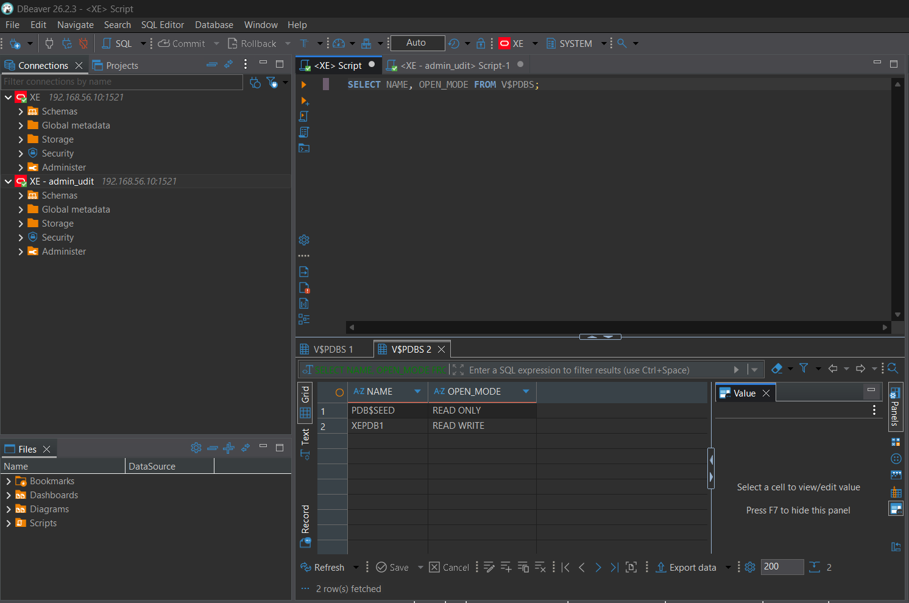

Así que la PDB existe y lo correcto en un entorno real sería crear el usuario dentro de `XEPDB1`. Pero como `admin_udit` está en el contenedor principal, hago todo ahí (conexión `XE`) con el `_ORACLE_SCRIPT`, como pide el reto. Ese truco es interno de Oracle y no se usaría en producción.

### 4.3 Crear `usuario_restringido`

Conectado como `admin_udit`:

```sql
ALTER SESSION SET "_ORACLE_SCRIPT" = TRUE;  -- excepción didáctica, no usar en producción

CREATE USER usuario_restringido IDENTIFIED BY "********";
GRANT CREATE SESSION TO usuario_restringido;

SELECT USERNAME, ACCOUNT_STATUS, CREATED
  FROM DBA_USERS
 WHERE USERNAME = 'USUARIO_RESTRINGIDO';
```

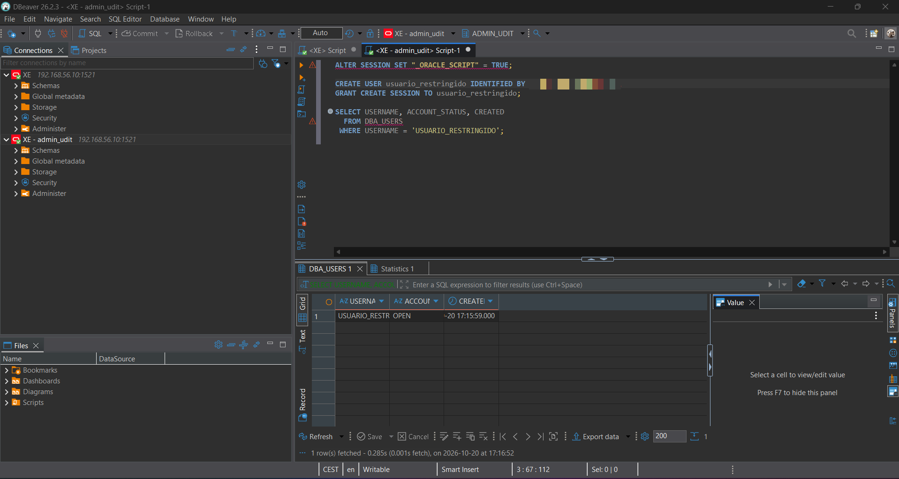

La contraseña la he pixelado en la captura. Solo le di `CREATE SESSION`: puede conectarse y nada más (ni siquiera leer tablas).

> La primera vez lo ejecuté con Ctrl+Enter y DBeaver mandó todo el script como si fuera una sola sentencia, así que Oracle dio `ORA-00922: missing or invalid option`. Con **Alt+X** (ejecutar script) va sentencia por sentencia y funcionó.

### 4.4 Demostrar el aislamiento

Nueva conexión en DBeaver con `usuario_restringido` (nombre `XE - usuario_restringido`). Conecta sin problema:

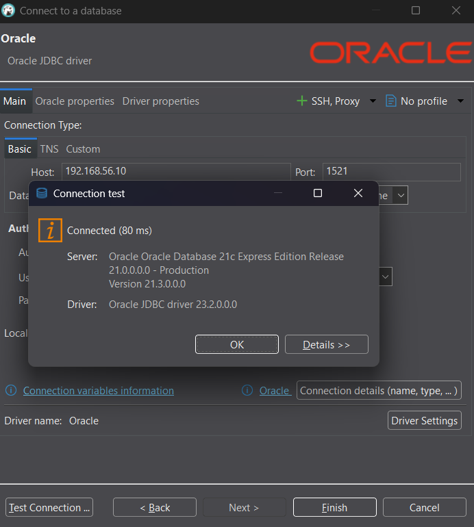

Intento crear otro usuario, tal cual viene en el enunciado:

```sql
CREATE USER usuario_prueba IDENTIFIED BY "Prueba_2026";
```

Pero no salió el error que esperaba, sino `ORA-65096: invalid common user or role name`:

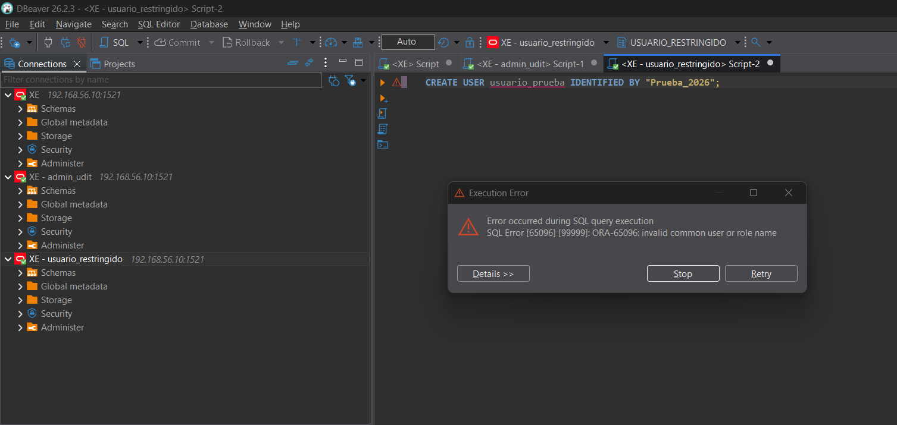

Esto pasa porque en el contenedor principal Oracle primero mira si el nombre es válido, y ahí solo valen nombres que empiecen por `C##`. Como `usuario_prueba` no empieza así, se para antes de llegar a mirar los permisos. Así que lo repetí con un nombre válido para ese contenedor:

```sql
CREATE USER c##usuario_prueba IDENTIFIED BY "Prueba_2026";
```

Ahora sí pasa la comprobación del nombre, llega a la de permisos y sale **`ORA-01031: insufficient privileges`**: `usuario_restringido` no puede crear usuarios.

📸 **Evidencia 4:** a la izquierda, como `admin_udit`, `USUARIO_RESTRINGIDO` existe y está `OPEN`; a la derecha, como `usuario_restringido`, el error `ORA-01031`.

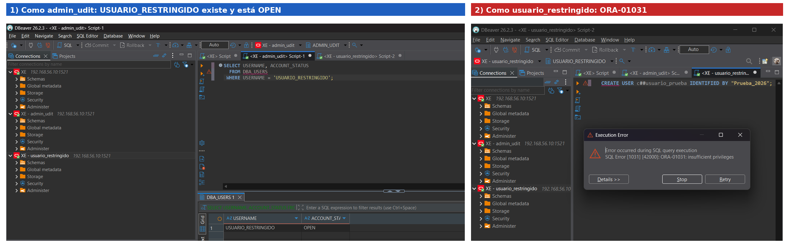

---

## 5. Fase 4 · Justificación técnica

**a)** ¿Qué diferencia existe entre un cierre ordenado de Oracle y una caída inesperada? Explica el efecto sobre las transacciones sin confirmar y la recuperación posterior.

> En un cierre ordenado (parar el servicio, o `SHUTDOWN IMMEDIATE` desde SQL*Plus) Oracle deshace las transacciones que no tienen `COMMIT`, escribe en los ficheros de datos lo que tenía pendiente en memoria y cierra los ficheros bien. Al volver a arrancar la base de datos está consistente y abre directamente.
>
> En una caída (se va la luz, se apaga la VM a lo bruto o un `SHUTDOWN ABORT`) todo lo que había en memoria se pierde de golpe y los ficheros de datos se quedan a medias. No se pierde lo confirmado porque cada `COMMIT` queda apuntado en los redo logs. Al arrancar, Oracle hace solo la recuperación de instancia: primero repasa los redo logs y vuelve a aplicar los cambios que faltaban en los ficheros, y después deshace con el undo lo que no estaba confirmado. Así que las transacciones sin confirmar se pierden en los dos casos; la diferencia es que en la caída el arranque tarda más y dependes de que los redo logs estén bien. Por eso en el Reto 1 apagué la VM desde Windows antes de hacer el snapshot.

**b)** ¿Qué diferencia hay entre que el firewall descarte una conexión TCP y que el Listener esté detenido? ¿Qué prueba utilizarías para distinguir ambas situaciones?

> Si el firewall descarta la conexión, el paquete se tira y no se contesta nada, así que el cliente se queda esperando hasta que se rinde. Me pasó en el Reto 1: el `Test-NetConnection` tardaba unos 20 segundos en dar `False`. Si el firewall deja pasar pero el listener está parado, Windows contesta al momento que en ese puerto no hay nadie (un reset), así que el fallo es inmediato, y desde un cliente Oracle sale `ORA-12541: TNS:no listener`.
>
> Para distinguirlos miraría dentro de la VM con `lsnrctl status` o `netstat -ano | findstr 1521`: si aparece `LISTENING`, el listener está bien y el problema viene de fuera (firewall). Si no aparece, es el listener. También ayuda que haya ping (la red funciona) y fijarse en si el `False` tarda (descarte del firewall) o es instantáneo (nadie escuchando).

**c)** ¿Qué permiso le falta al usuario restringido para crear otro usuario? ¿Por qué es peligroso utilizar una cuenta con privilegios administrativos para todas las tareas?

> Le falta el privilegio de sistema `CREATE USER` (lo tiene `admin_udit` a través del rol `DBA`). Con solo `CREATE SESSION` puede entrar, pero nada más.
>
> Usar una cuenta administrativa para todo es peligroso porque cualquier error tiene el máximo alcance: un `DROP` o un `DELETE` mal hecho puede cargarse datos o usuarios de toda la base de datos. Si alguien roba esa contraseña tiene el control completo, y si todo el mundo usa la misma cuenta no hay forma de saber quién ha hecho cada cosa. Dando a cada uno solo lo que necesita, si algo sale mal el daño se queda limitado.

---

## 7. Checklist de evidencias

- [x] **Evidencia 1:** pestaña Ámbito del Firewall con la IP autorizada
- [x] **Evidencia 2:** `Test-NetConnection` exitoso del cliente autorizado y resultado negativo desde una máquina no autorizada
- [x] **Evidencia 3:** DBeaver conectado desde el cliente autorizado como `admin_udit`
- [x] **Evidencia 4:** `USUARIO_RESTRINGIDO` en estado `OPEN` y error `ORA-01031`
- [x] Fase 4: tres justificaciones redactadas
